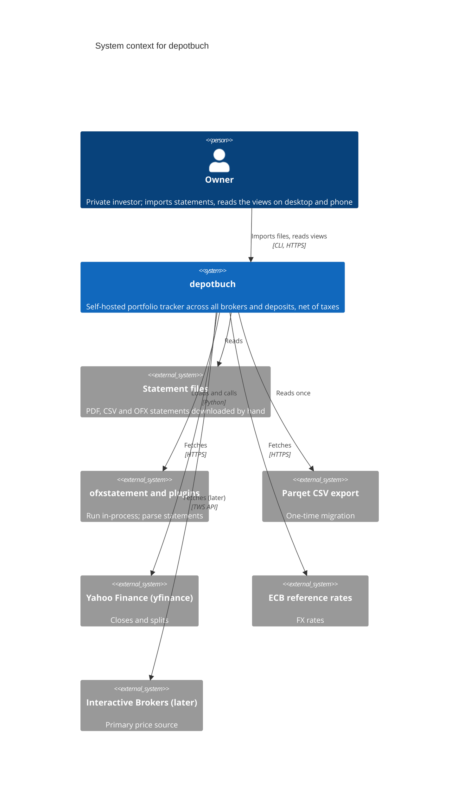

# 3. Context and scope

> Living document. The system from outside. Open questions are marked **[OPEN]** inline.

## 3.1 System context

depotbuch has one user, the owner, who downloads statements by hand from each provider and
imports them. depotbuch never logs in to a bank or broker. Its only outbound network calls
fetch prices and FX rates.

The source is [`diagrams/c4-context.mermaid`](diagrams/c4-context.mermaid), which also shows
Autobook and GnuCash, which share the ofxstatement plugins but have no runtime link to
depotbuch.

## 3.2 External interfaces

| Interface | Direction | Format | Trust |
|-----------|-----------|--------|-------|
| Statement files (Consorsbank, Scalable, Revolut, deposit banks) | In, by `depot import` | PDF, CSV, OFX (XML or SGML) | Untrusted content: parsed defensively, every row reported as added, skipped or rejected. |
| ofxstatement plugins | In-process call | Python `Statement` objects, rendered with `OfxWriter` and re-parsed as OFX | The plugin code is trusted (installed by the owner from known repositories); its output is validated like a file. |
| Plugin contract | Plugins → depotbuch | `statement.invest_lines` (ofxstatement 0.9+), ISIN in `security_id`, settlement currency in `statement.currency`; deposits as bank `statement.lines` | Untrusted data. None of the existing plugins meets the contract yet (see below). |
| Parqet CSV export | In, once | Semicolon-separated, header-driven; Buy, Sell, Dividend, Interest, TransferIn, TransferOut | Untrusted content. Rows carry no ID; the activity ID is a hash of the row plus its occurrence number among identical rows in the file. |
| Price provider: yfinance (Yahoo Finance) | Out, by `depot update` | Daily closes adjusted for splits but not dividends; split events | Untrusted data from a third party. Personal-use terms. |
| Price provider: Interactive Brokers (later) | Out | TWS API via TWS or IB Gateway | Licensed; untrusted data. |
| Manual price CSV | In | CSV | Owner's own data. |
| FX: ECB reference rates | Out, by `depot update` | Daily rates | Untrusted data from a public source. |
| CLI (`depot …`) | Owner ↔ system | Text tables or `--json` | Trusted: runs as the owner on the server. |
| Web API (Django Ninja, `/api/`) and front end | Owner ↔ system | JSON over HTTPS, OpenAPI | Authenticated owner only; TLS and login required. |
| Static HTML report (`depot report -o FILE`) | Out | One self-contained HTML file | Contains the full portfolio; as sensitive as the database. |

**State of the plugins.** All three existing plugins read cash accounts only and emit bank
lines. Consorsbank needs a new parser for trade and dividend confirmations
(Wertpapierabrechnung). Scalable can turn the units and ISIN already in its memos into
investment lines and attach the same-day trade fee. Revolut needs a new parser for the
trading statement. Tagesgeld and broker interest already arrive as `INT` lines.

**[OPEN]** Plugin work order: Scalable first, then Consorsbank trade confirmations, then
Revolut trading statements? Until each is done, its new trades need manual entry or a fresh
Parqet export.

**[OPEN]** Which banks hold Tagesgeld and Festgeld, and does an ofxstatement plugin exist for
each?

## 3.3 Out of context

- **Banks' and brokers' online access.** No login, no screen scraping, no FinTS, no broker
  API. Fetching statements stays with the owner. FinTS is noted as a possible later adapter.
- **GnuCash and Autobook.** They share the plugins and the input format but are not called by
  depotbuch, and depotbuch does not write to a GnuCash book.
- **Parqet itself.** Read only through its CSV export, and compared by hand during the
  parallel run.
- **Tax authorities and tax reports.** Taxes are shown per activity and per range; no tax
  report is produced.
- **Other users and devices.** No sharing, no multi-user, no mobile app; the phone uses the
  web front end.
