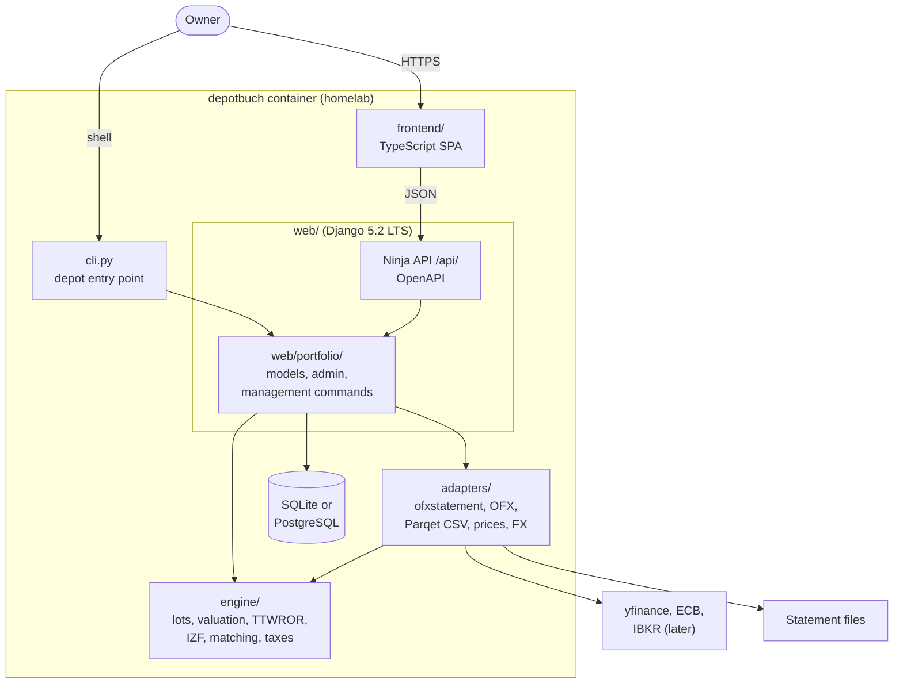

# 5. Building block view

> Living document. The components and what each is responsible for. Open questions are marked **[OPEN]** inline.

## 5.1 Components

One Python package, `depotbuch`, under `src/`, plus a TypeScript front end. Dependencies point
inward: the engine depends on nothing in the project, adapters depend on the engine's types,
and only `web/` and the CLI import Django.

| Component | Path | Responsibility | Django? | Critical |
|-----------|------|----------------|---------|----------|
| Engine | `src/depotbuch/engine/` | Pure functions from activities, prices and FX rates to results: holdings, FIFO lots, valuation per asset type, Festgeld accrual, TTWROR, IZF, trade-to-cash matching, tax attribution, Parqet-compatible mode. `decimal.Decimal` and pydantic types. | No (lint-enforced) | **Correctness-critical**: every figure comes from here. |
| Case harness | `src/depotbuch/testing/` | Test support, not part of the product: loads TOML case files into engine types and checks expectations in both modes; `reconcile` runs a private corpus of real statements outside the repository (`nox -s reconcile -- <path>`, never in the gate or CI). | No | **Confidentiality-critical**: handles the private corpus; prints nothing taken from it (§14.7). |
| Adapters | `src/depotbuch/adapters/` | Turn outside data into engine types: ofxstatement plugins (in-process, via `OfxWriter` and OFX parsing), OFX files, Parqet CSV, price providers (yfinance now, IBKR later, manual CSV), ECB FX. One price-provider interface, chosen per security. Later FinTS. | No | **Security-critical**: parses untrusted files and network data. |
| Portfolio app | `src/depotbuch/web/portfolio/` | Django models for what the engine reads (portfolio, providers, accounts, assets, activities, prices, FX, valuations, Festgeld terms, symbol mappings), migrations, admin for accounts and corrections, the management commands behind `depot`. Idempotent imports keyed on account + `FITID`. | Yes | Correctness-critical (identity and deduplication of activities). |
| Web project and API | `src/depotbuch/web/` | Settings, URLs, login, Django Ninja JSON API at `/api/` with an OpenAPI schema. Every endpoint calls the engine; none computes figures itself. | Yes | **Security-critical**: the only network-facing surface. |
| CLI | `src/depotbuch/cli.py` | The `depot` entry point, a thin wrapper over the management commands. Every feature, with `--json`. | Yes | — |
| Front end | `frontend/` (not yet created) | TypeScript SPA: the seven views, interactive charts, the GnuCash-based design system as CSS. API client generated from the OpenAPI schema. | — | Displays only; no calculations. |
| HTML report | part of the CLI | `depot report -o FILE`: all views as one self-contained HTML file for offline use. | Yes | Output contains the full portfolio. |

The domain model the engine and the portfolio app share is in §8.1.

## 5.2 Layers

| Layer | May import | Must not import |
|-------|-----------|-----------------|
| `engine` | standard library, pydantic | Django, adapters, network libraries |
| `adapters` | engine, ofxstatement, yfinance, HTTP clients | Django |
| `web`, `web.portfolio`, `cli` | everything above, Django, Django Ninja | — |
| `frontend` | the generated API client | anything server-side |

The rule that keeps the engine and adapters free of Django and Django Ninja is checked twice
in the gate: ruff's banned-API rule (TID251) catches a direct import, and
`tests/test_boundaries.py` imports each package in a fresh interpreter to catch a transitive
one. mypy runs `--strict` with django-stubs over all layers.

## 5.3 Views and commands

Every report command and API endpoint takes the same filters: provider, account, asset class,
range (YTD, 1 year, 3 years, since purchase, custom), as-of date, `--parqet` and `--json`.

| View | Command | Shows |
|------|---------|-------|
| Providers | `depot providers` | One row per provider and a total: value, inflows, outflows, income, taxes, absolute gain, TTWROR, IZF. Selecting a row filters every other view. |
| Dashboard | `depot dashboard` | Tiles (value, invested capital, price gain, income, realized gain, taxes, TTWROR, IZF), value and TTWROR chart, allocation by asset class and provider, top and bottom 3 assets. |
| Holdings | `depot holdings` | One row per asset grouped by asset class, with totals per class and overall. |
| Holding detail | `depot holding ID` | Header metrics, price or valuation chart with activities marked, open and realized lots or Festgeld terms, the asset's activities. |
| Lots | `depot lots [--realized]` | Every open lot with cost, value, dividends, gain after tax, return since purchase, p.a. from 365 days. |
| Income | `depot income [--by month\|year\|asset]` | Dividends and interest: gross, withheld tax, net; last 12 months and monthly average. |
| Activities | `depot activities [--type T] [--export FILE]` | All activities with source file and import date; add, edit, delete; CSV export in Parqet's import format. |

Other commands: `depot import FILE… [-t TYPE] [-a ACCOUNT]`, `depot account add|edit`,
`depot add` / `edit ID` / `delete ID`, `depot valuation add ACCOUNT DATE VALUE` (step 2),
`depot update [--since DATE]`, `depot asset [ID] …`, `depot report -o FILE`.

## 5.4 Build-time components

| Component | Purpose |
|-----------|---------|
| `noxfile.py` | The gate, `nox -s gate`: ruff format and lint, mypy `--strict` with django-stubs, pytest with Hypothesis, typos, the docs checks. |
| `.github/workflows/ci.yml` | Runs the gate and a test matrix over Python 3.11 to 3.14. |
| `.github/docs-check/` | Link and ADR-index checks for the design docs. |
| Hand-computed cases | Test fixtures for every calculation rule, in default and Parqet-compatible mode (§13). |
| OpenAPI client generator | Generates the front end's API client from the Ninja schema. **[OPEN]** Which generator, decided with the front-end design proposal. |
