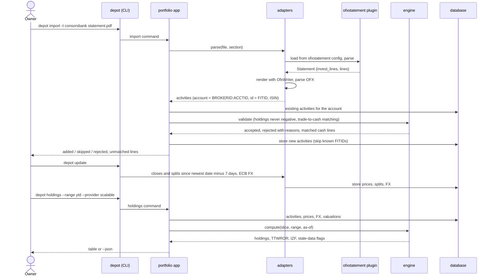

# 6. Runtime view

> Living document. How the components work together on the important paths. Open questions are marked **[OPEN]** inline.

## 6.1 The main path: statement in, report out

The owner imports a statement, updates market data, and reads a view. The import path is
where correctness is won or lost: identity, deduplication and the per-row report.

The web front end follows the same last step through the Ninja API instead of the CLI.

## 6.2 Other important paths

**Re-import and overlap.** An activity's identity is account plus `FITID` (for Parqet CSV, a hash of
the row plus its occurrence number among identical rows in the file, so two identical buys
on one day stay two activities). Importing the same file again adds nothing and reports
every row as skipped. Overlapping statements are safe for the same reason.

**A sale larger than the holding.** Rejected with the date and the missing units, because it
means earlier activities are missing. Nothing is stored for that row; the rest of the file
imports.

**Unknown security key.** A plugin that emits a ticker or WKN instead of an ISIN is mapped to
an ISIN once (by the owner) and the mapping is remembered.

**Trade-to-cash matching.** Each investment activity is matched to its cash line on the
Verrechnungskonto by provider, amount and a booking date up to 3 business days later. The
matched cash line is not counted again; unmatched lines on either side are listed in the
import report.

**Deposits.** Bank lines from deposit accounts are classified by the account's configured
asset type, not guessed per line. Festgeld placements carry principal, rate, start and
maturity entered once with `depot account add`; the engine accrues interest daily until the
maturity statement arrives.

**Missing or stale market data.** The last close or valuation is carried forward over
weekends, holidays and gaps. A held asset is never valued at zero for lack of data. Reports
flag a security whose newest close is older than 5 days and a contract whose newest
valuation is older than 13 months.

**Corrections.** `depot add`, `edit` and `delete` (and the admin) change activities; since
everything else is derived, the next report reflects the change with no migration.

**Login and API access.** Every web and API request requires an authenticated session over
TLS. **[OPEN]** Session login only, or also an API token for scripts? Decide with the backend
milestone and update §14.

**Parallel run.** Reports run with `--parqet` reproduce Parqet's treatment of taxes and fees
(§8.4) so the figures can be compared within the acceptance tolerances (§10).
