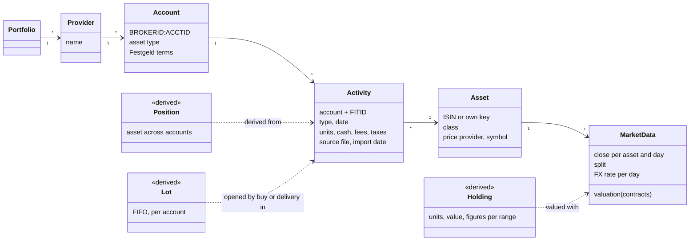

# 8. Cross-cutting concepts

> Living document. The core ideas the rest of the design is built on. Terms are also in the glossary (section 12). Open questions are marked **[OPEN]** inline.

## 8.1 Activities are the only stored fact

An activity (buy, sell, dividend, interest, transfer, fee, split, deposit, withdrawal, and in
step 2 contribution and allowance) is the only fact depotbuch stores about a position.
Holdings, lots, values and every report are recomputed from activities plus market data.
Re-imports, corrections and method changes (FIFO to average, say) therefore need no data
migration (ADR-0006, Proposed).

One portfolio holds all providers; a provider holds accounts (a depot, a Verrechnungskonto, a
Tagesgeld account, each Festgeld deposit); an account holds activities, and each activity
refers to one asset. A position is an asset across accounts. In step 2, a pension contract
is one more account whose asset is the contract, valued from its statements.

The spec's domain-model diagram (6 stored entities, 3 derived) was lost when the spec was
exported to Markdown. The diagram below is **reconstructed from the spec text**; the exact
entity split is to be confirmed when the models are written.

## 8.2 Valuation

Every figure is computed in EUR, for a time range and for any slice: whole portfolio,
provider, account, asset class or single asset.

| Asset type | Value on a day |
|------------|----------------|
| Security | Units × close × FX. Closes are adjusted for splits but not for dividends, which are booked as activities. |
| Tagesgeld, Verrechnungskonto | Account balance from bank statements. |
| Festgeld | Principal plus interest accrued daily at the contract rate, until the maturity statement. |
| Pension contract (step 2) | Last statement value held flat until the next; fund units × fund price where the contract reports units. |

The last close or valuation is carried forward over gaps; a held asset is never valued at
zero for lack of data. An activity is converted at the broker's rate when the statement gives
one, otherwise at the ECB rate for that day. Foreign-currency assets include the FX effect.

## 8.3 Lots and FIFO

Each buy or delivery in opens a lot. Sales close lots first-in first-out within the same
account, as German tax law does. Dividends are split across the lots held on the payment
date in proportion to units. Splits restate history onto the current basis. A dividend paid
after a full sale is added to the position's last held day. Average and LIFO are later
options; because lots are derived, adding them needs no migration.

**[OPEN]** Does Parqet apply FIFO per sub-depot or per portfolio? This changes realized gains
when the same ISIN sits in two depots, and so the parallel run.

## 8.4 Performance and taxes

- **TTWROR** splits the range at every activity and chains daily sub-period returns:
  inflows enter at the start of the day, outflows and income at the end. Fees are part of
  inflows and outflows, so they reduce the return. Shown for the range, never annualized. A
  range with no start value and no inflows has no TTWROR (shown as —).
- **IZF** is the annualized internal rate of return, with the start value as an outflow on
  the first day and the end value as an inflow on the last.
- **Taxes are deducted by default** (withholding, Abgeltungsteuer, Soli, church tax; refunds
  negative). A tax on a sale or dividend belongs to that asset; a tax reported only as a
  yearly total belongs to the provider, so provider and portfolio figures stay right.
- **Parqet-compatible mode** (`--parqet`) follows Parqet's FAQ: taxes and fees on buys, sales
  and dividends do not reduce the return, while costs booked directly to the cash account
  still do. It exists only for the parallel run (ADR-0012, Proposed).

The formulas are in proposal 0001, *Calculations*.

## 8.5 Cash accounts and no double counting

Each provider's Verrechnungskonto is an asset valued at its balance, so idle cash earns 0 %
and lowers TTWROR, as in Parqet. For a single security, buys and sales are flows; for a
provider or the portfolio they only move value between cash and the security, and the flows
are transfers in or out of the cash account from untracked accounts such as the Girokonto.
Whether a bank line is such a transfer is decided by the account configuration, not guessed.

A trade appears twice, as an investment activity and as its cash line (for example `EFFEKTEN`
at Consorsbank). Each investment activity is matched to its cash line by provider, amount and
a booking date up to 3 business days later; the matched line is not counted again, and
unmatched lines on either side are reported.

**[OPEN]** Parallel run: does the Parqet portfolio hold every Verrechnungskonto that depotbuch
tracks? Both tools must include the same cash, since idle cash dilutes TTWROR.

## 8.6 Money and numbers

Amounts are `decimal.Decimal` from parsing to output; binary floats never hold money. Each
amount carries its currency until it is converted to EUR. Rounding to the cent happens only
for display and for comparison with Parqet; intermediate results keep full precision.
**[OPEN]** Rounding mode and the precision of stored prices and FX rates, decided with the
engine milestone.

## 8.7 Imports: identity, reporting, nothing silent

- An activity's identity is account plus `FITID`; Parqet rows use a hash of the row.
- The security key is the ISIN; tickers and WKNs are mapped once and remembered.
- The account is `BROKERID:ACCTID` from the statement, overridable per import.
- Each import reports added, skipped and rejected rows, and unmatched cash lines. Nothing is
  dropped silently.
- A sale larger than the holding is rejected with the date and the missing units.

## 8.8 Build and CI

`nox -s gate` is the single gate, run locally and as the required `gate` check in CI: ruff
format and lint (including the banned-API rule that keeps Django out of the engine and
adapters), mypy `--strict` with django-stubs, pytest with Hypothesis, typos and the docs
checks. CI also runs the test suite on Python 3.11 to 3.14. Every action is pinned to a
commit hash.

## 8.9 Security

The threat model is §14, summarized for reviewers in
[`.oss-scanner/threat_model.md`](../../../.oss-scanner/threat_model.md). A change that adds an
untrusted input (a new statement format, plugin, price source or API endpoint) or moves a
trust boundary (login, deployment, network exposure) updates both in the same PR.
